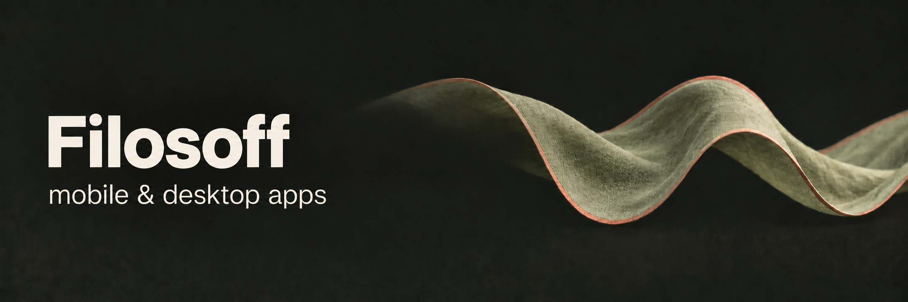
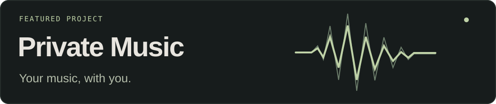
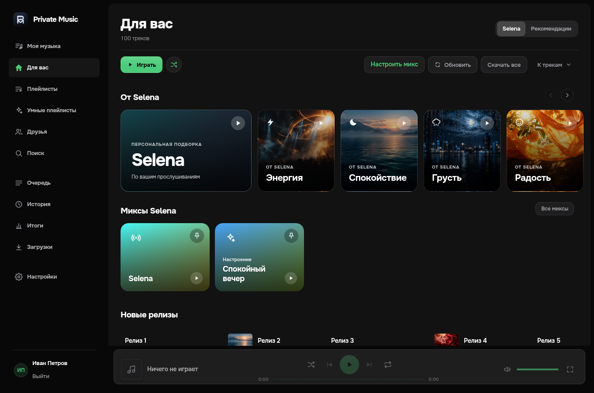

  

  <samp>
    <a href="https://github.com/decoder-dev?tab=repositories">projects</a> &nbsp;·&nbsp;
    <a href="https://github.com/decoder-dev/PrivateMusicDesktop/releases/latest">releases</a> &nbsp;·&nbsp;
    <a href="https://github.com/decoder-dev?tab=achievements">achievements</a>
  </samp>

<strong>English</strong> · <a href="README.ru.md">Русский</a>

### Hi, I'm Filosoff.

I build apps for Android, iPhone and desktop — from the interface to the engine underneath. My main project is **Private Music**, with **MAUverse** and a few smaller tools alongside it.

 

<a href="https://github.com/decoder-dev/PrivateMusicDesktop">
  <picture>
    <source media="(max-width: 600px)" srcset="assets/private-music-mobile-en.svg" />
    
  </picture>
</a>

An unofficial VK Music client for **Android, iOS, Windows, macOS and Linux**.

- **Listen your way.** Personal mixes, synced lyrics, queue controls and a 10-band equalizer.
- **Take it offline.** Download tracks and playlists, manage the local library and keep listening without a connection.
- **Go beyond the screen.** Background playback, system media controls and desktop mini-player.

Rust and Tauri power the Android/desktop app, with Kotlin platform integrations. The iPhone client is built with SwiftUI.

**[Android & desktop ↗](https://github.com/decoder-dev/PrivateMusicDesktop)** &nbsp; / &nbsp; **[iPhone ↗](https://github.com/decoder-dev/PrivateMusic2)** &nbsp; / &nbsp; **[Latest release ↗](https://github.com/decoder-dev/PrivateMusicDesktop/releases/latest)**

<strong>Explore the interface — desktop & Android</strong>

 

  

Interface previews from the project repository, using demo tracks and placeholder artwork.

 

### More projects

- **[MAUverse](https://github.com/decoder-dev/mauverse)** — university schedules, news and services. Built with .NET MAUI for Android and SwiftUI for iPhone.
- **[decoder sec.](https://github.com/decoder-dev/decoder-sec)** — an iOS proxy client powered by Xray, sing-box and mihomo.
- **[SafeDesk](https://github.com/decoder-dev/safedesk)** — a remote desktop app built with Rust.
- **[Pyke](https://github.com/decoder-dev/pyke)** — an experimental language for mathematics and computer science, with Python-like syntax and C99 output.

 

### What I work with

`Swift` `SwiftUI` `Kotlin` `Rust` `C#` `.NET MAUI` `Python` `JavaScript`

[Player architecture](https://github.com/decoder-dev/PrivateMusicDesktop/blob/main/docs/android.md) &nbsp;·&nbsp; [Questions & ideas](https://github.com/decoder-dev/PrivateMusicDesktop/discussions) &nbsp;·&nbsp; [Feedback](https://github.com/decoder-dev/PrivateMusicDesktop/issues)
