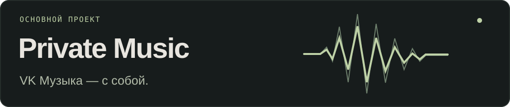

  

  <samp>
    <a href="https://github.com/decoder-dev?tab=repositories">проекты</a> &nbsp;·&nbsp;
    <a href="https://github.com/decoder-dev/PrivateMusicDesktop/releases/latest">релизы</a> &nbsp;·&nbsp;
    <a href="https://github.com/decoder-dev?tab=achievements">достижения</a>
  </samp>

<a href="https://github.com/decoder-dev">English</a> · <strong>Русский</strong>

### Привет, я Filosoff.

Делаю приложения для Android, iPhone и компьютеров — от интерфейса до движка. Основной проект — **Private Music**. Параллельно работаю над **MAUverse** и небольшими инструментами.

 

<a href="https://github.com/decoder-dev/PrivateMusicDesktop">
  <picture>
    <source media="(max-width: 600px)" srcset="assets/private-music-mobile-ru.svg" />
    
  </picture>
</a>

Неофициальный клиент VK Музыки для **Android, iOS, Windows, macOS и Linux**.

- **Слушать по-своему.** Персональные миксы, синхронные тексты, управление очередью и десятиполосный эквалайзер.
- **Брать музыку с собой.** Загрузка треков и плейлистов, управление локальной библиотекой и прослушивание без интернета.
- **Управлять удобнее.** Фоновое воспроизведение, системные медиакнопки и отдельный мини-плеер на компьютере.

Версия для Android и ПК работает на Rust и Tauri с интеграциями на Kotlin. Клиент для iPhone написан на SwiftUI.

**[Android и ПК ↗](https://github.com/decoder-dev/PrivateMusicDesktop)** &nbsp; / &nbsp; **[iPhone ↗](https://github.com/decoder-dev/PrivateMusic2)** &nbsp; / &nbsp; **[Последний релиз ↗](https://github.com/decoder-dev/PrivateMusicDesktop/releases/latest)**

<strong>Посмотреть интерфейс — компьютер и Android</strong>

 

  

Превью из репозитория проекта на тестовых треках. Изображения заменяют обложки тестового каталога.

 

### Ещё проекты

- **[MAUverse](https://github.com/decoder-dev/mauverse)** — расписание, новости и сервисы университета. Android на .NET MAUI, iPhone на SwiftUI.
- **[decoder sec.](https://github.com/decoder-dev/decoder-sec)** — прокси-клиент для iOS на базе Xray, sing-box и mihomo.
- **[SafeDesk](https://github.com/decoder-dev/safedesk)** — удалённый рабочий стол на Rust.
- **[Pyke](https://github.com/decoder-dev/pyke)** — экспериментальный язык для математики и информатики с синтаксисом в духе Python и компиляцией в C99.

 

### С чем работаю

`Swift` `SwiftUI` `Kotlin` `Rust` `C#` `.NET MAUI` `Python` `JavaScript`

[Устройство плеера](https://github.com/decoder-dev/PrivateMusicDesktop/blob/main/docs/android.md) &nbsp;·&nbsp; [Вопросы и идеи](https://github.com/decoder-dev/PrivateMusicDesktop/discussions) &nbsp;·&nbsp; [Обратная связь](https://github.com/decoder-dev/PrivateMusicDesktop/issues)
